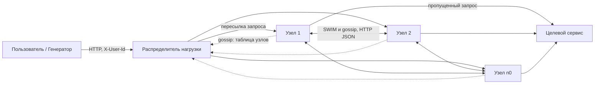
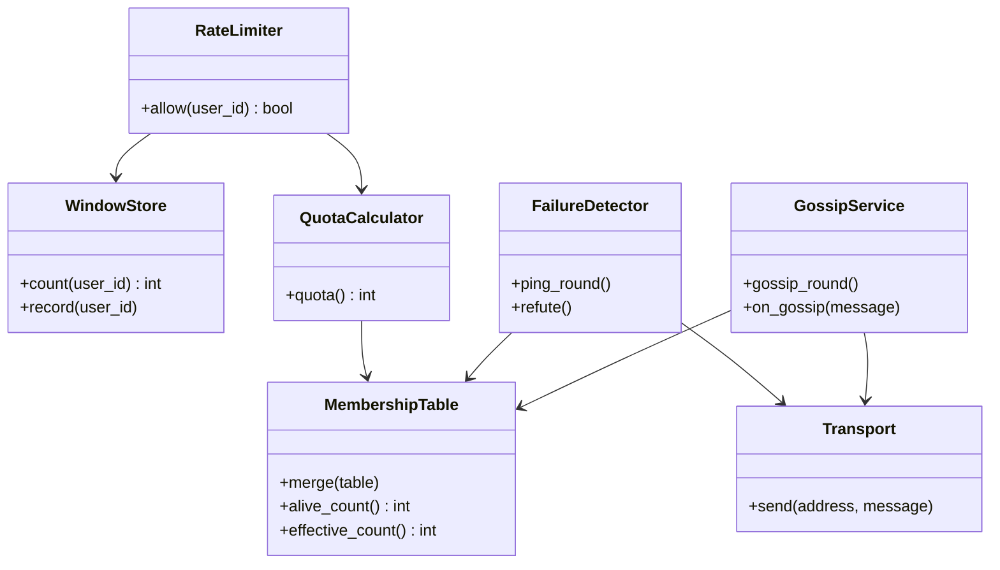
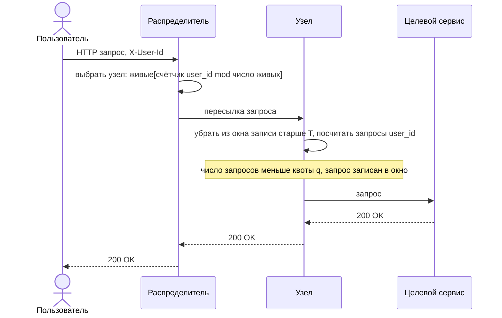
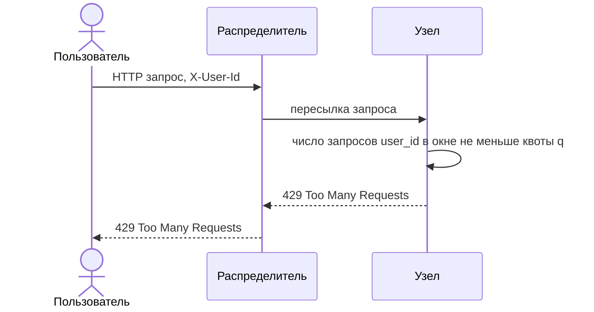
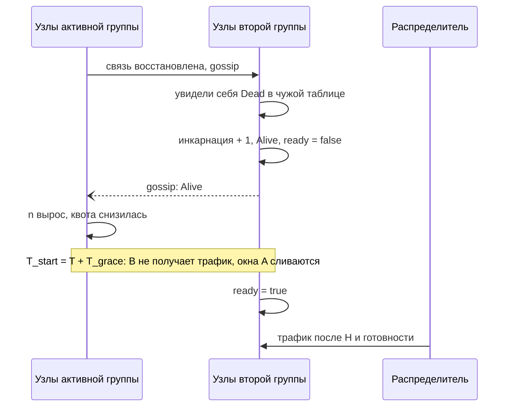
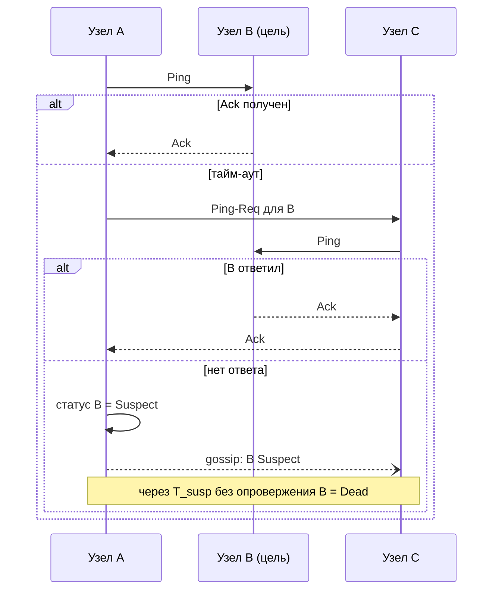

# Техническое решение проекта «Middleware»

## Введение
- **Бизнес-задача:**
	Целевой сервис принимает поток запросов от пользователей. При резком скачке трафика - например, из-за всплеска активности одного пользователя - одиночный сервер не справляется с нагрузкой: растет задержка ответа, вплоть до отказа обслуживания.
	Для защиты сервиса перед ним ставится слой фильтрации трафика (rate limiting middleware), ограничивающий число запросов от каждого пользователя за единицу времени. На одном узле этот слой сам становится узким местом (bottleneck) и единой точкой отказа (single point of failure): при его отказе весь трафик уходит на сервис без ограничений, либо сервис становится недоступен.
	Лимит нужен владельцу сервиса как граница нагрузки, поэтому система обещает не «примерное», а проверяемую верхнюю границу числа пропущенных запросов (см. нефункциональные требования).

- **Идея решения:**
	Распределённый слой фильтрации состоит из фиксированного набора $n_0$ равноправных узлов middleware и распределителя нагрузки, вынесенного за пределы кластера. Централизованного хранилища счётчиков нет. Глобальный лимит $L$ и окно $T$ задаются в конфигурации до запуска и не меняются во время работы.
	Узлы делят лимит на **квоты**: каждый узел пропускает не более $q = ⌊L / n⌋$ запросов одного пользователя за окно $T$, где $L$ - глобальный лимит, $n$ - число живых узлов. Узлы согласуют через gossip только таблицу узлов, из которой каждый локально вычисляет $n$. Распределитель равномерно раздаёт запросы пользователя по узлам и при разделении сети направляет трафик только в одну группу, выбранную в момент разделения. Квота уменьшается сразу, а увеличивается только после выдержки $T_{hold} = T + T_{grace}$. Узел, вернувшийся из статуса Dead, сразу учитывается в $n$, но проходит карантин $T_{start} = T + T_{grace}$ и в это время не получает трафик. За счёт этого верхняя граница $L$ сохраняется и при отказах.

- **Краткое описание:**
	Distributed rate limiting middleware - учебный проект, реализующий прототип промежуточного слоя фильтрации запросов, который стоит перед целевым сервисом, ограничивает трафик и сохраняет работоспособность при отказе части узлов.

	Проект является распределённой системой, потому что:
	- состоит из нескольких независимых узлов, каждый со своей локальной памятью
	- узлы не имеют общей памяти и общаются сообщениями по сети
	- представление о составе кластера согласуется между узлами асинхронно; лимит $L$ и окно $T$ фиксированы
	- система сохраняет работоспособность при отказе отдельных узлов и сетевых разделениях

- **Цель проекта:**  
	Реализовать прототип распределённого middleware, который:
	- ограничивает число запросов от каждого пользователя за скользящее окно времени с проверяемой верхней границей $L$
	- сохраняет работоспособность при отказе отдельных узлов и сетевых разделениях
	- обеспечивает сходимость представления узлов о составе кластера за конечное время

- **Задачи:**
	- спроектировать архитектуру распределённого middleware
	- реализовать приём запросов, распределитель нагрузки и локальный учёт запросов по скользящему окну
	- реализовать вычисление квот по числу живых узлов
	- реализовать обнаружение отказов (SWIM) и gossip-рассылку
	- реализовать правила, сохраняющие границу $L$ при отказах, возвратах узлов и разделениях сети
	- реализовать генератор нагрузки, тестирование и chaos-сценарии

- **Основания для разработки:**  
	учебный проект по курсу «Основы распределённых вычислений» в СПбГУ.

- **Команда:**  
	- Хасанов Тимур, TeamLead & Backend developer
	- Смирнов Егор, Backend developer
	- Бабушкин Виталий, Backend developer
	- Сотников Иван, Backend developer

---

## Глоссарий
| Термин                      | Определение                                                                                                                                                                                                                                      |
| --------------------------- | ------------------------------------------------------------------------------------------------------------------------------------------------------------------------------------------------------------------------------------------------ |
| Целевой сервис              | Сервис, который обрабатывает запросы, пропущенные middleware. В прототипе - заглушка, возвращающая `200 OK`.                                                                                                                                     |
| Middleware                  | Промежуточный слой между пользователем и целевым сервисом, который выполняет фильтрацию запросов.                                                                                                                                                |
| Пользователь                | Клиент системы, идентифицируемый значением `user_id`                                                                                                                                                                                             |
| Глобальный лимит $L$        | Максимальное число запросов одного `user_id`, пропускаемых системой за скользящее окно $T$. Задаётся в файле конфигурации до запуска системы и не меняется                                                                                       |
| Скользящее окно             | Интервал длины $T$, непрерывно движущийся вместе с текущим моментом. Запросы старше $T$ не учитываются.                                                                                                                                          |
| Окно $T$                    | Длительность скользящего окна. Задаётся при запуске и не меняется во время работы.                                                                                                                                                               |
| Узел                        | Самостоятельный экземпляр middleware, считающий запросы пользователей локально.                                                                                                                                                                  |
| Кластер                     | Множество из $n₀$ узлов middleware. Распределитель в кластер не входит.                                                                                                                                                                          |
| Живой узел                  | Узел, находящийся не в статусе Dead (Alive и Suspect) дольше $T_{hold}$. Используется при расчёте $n$.                                                                                                                                           |
| Эффективное число узлов $n$ | Число узлов, которые не находятся в статусе Dead дольше $T_{hold}$, включая узлы в карантине $T_{start}$. По нему считается квота.                                                                                                               |
| Квота $q$                   | Максимальное число запросов одного `user_id`, которое узел может пропустить за окно: $q = ⌊L / n⌋$.                                                                                                                                              |
| Распределитель нагрузки     | Отдельный сервис, принимающий внешние запросы и пересылающий их узлам. Не входит в кластер, не считает квоту и не рассылает gossip, но принимает gossip-сообщения. При разделении фиксирует активную группу.                                     |
| Группа узлов                | Множество узлов, которые взаимно считают друг друга Alive. При разделении сети кластер распадается на группы.                                                                                                                                    |
| Активная группа             | Группа, которой распределитель направляет трафик. Выбирается при разделении и не заменяется другой группой, пока связность не восстановится.                                                                                                     |
| Сетевое разделение          | Ситуация, когда связь между узлами нарушена и кластер распадается на изолированные группы.                                                                                                                                                       |
| SWIM                        | Протокол обнаружения отказов: прямая проверка (Ping), косвенная проверка (Ping-Req), статус Suspect, исключение (Dead), опровержение.                                                                                                            |
| Инкарнация                  | Число, которое узел увеличивает, чтобы опровергнуть слух о своём отказе; при запуске равно времени старта в мс. Позволяет отличить новое состояние узла от устаревшего.                                                                          |
| Таблица узлов               | Локальная in-memory таблица узла: для каждого `node_id` адрес, статус (Alive / Suspect / Dead), инкарнация, признак `ready`.                                                                                                                     |
| Признак `ready`             | Флаг узла «готов принимать трафик». Равен `false` в течение $T_{start}$ после запуска, после паузы и после возврата из Dead, если узел при этом выпадал из списка живых. Узел, непрерывно остававшийся в списке живых, сохраняет `ready = true`. |
| Удержание $T_{hold}$        | Выдержка $T + T_{grace}$ после установки статуса Dead, по истечении которой узел перестаёт учитываться в $n$.                                                                                                                                    |
| Карантин $T_{start}$        | Выдержка $T + T_{grace}$ после запуска, паузы или возврата из Dead, в течение которой узел уже учитывается в $n$, но не получает трафик.                                                                                                         |
| Запас $T_{grace}$           | Дополнительное время к $T$, покрывающее задержку gossip, устаревание таблиц у распределителя и его период.                                                                                                                                       |
| Выдержка возврата $H$       | Время, в течение которого узел должен непрерывно оставаться в активной группе, прежде чем распределитель включит его в список живых. Служит против перепадов, а не для гарантии лимита.                                                          |
| Список живых узлов          | Узлы, которым распределитель направляет клиентский трафик: активная группа, `ready = true`, непрерывное пребывание в группе не менее $H$.                                                                                                        |
| Единая точка отказа (SPOF)  | Компонент, отказ которого приводит к отказу всей системы.                                                                                                                                                                                        |
| Сходимость                  | Свойство, описывающее что при восстановленной связи и продолжающейся доставке сообщений таблицы узлов на всех узлах совпадают за конечное время.                                                                                                 |
| Сценарий нагрузки           | Последовательность действий генератора, имитирующая нагрузку на систему.                                                                                                                                                                         |
| Ожидания сценария           | Ожидаемая реакция системы на сценарий нагрузки: число ответов `200` и `429`.                                                                                                                                                                     |
| Генератор                   | Отдельный сервис, генерирующий запросы к системе по заданным сценариям нагрузки.                                                                                                                                                                 |
| Chaos-сценарии              | Тесты, моделирующие остановку узлов, разделение сети и другие аномалии.                                                                                                                                                                          |
| TTL                         | (time-to-live) время жизни записи о выполненном запросе пользователя                                                                                                                                                                             |
| TTL-кэш                     | хранилище, удаляющее записи по критерию истечения TTL                                                                                                                                                                                            |

---

## Функциональные требования
Система должна предоставлять следующие функции:
- Приём запросов от пользователей.
- Ограничение числа запросов от одного пользователя в рамках скользящего окна времени.
- Пропуск запроса к целевому сервису с ответом `200 OK`, если лимит не превышен.
- Отклонение запроса с ответом `429 Too Many Requests`, если лимит превышен.

### Ограничения на предметную область
- Система развёртывается на одной машине через `docker compose`.
- Целевой сервис - заглушка, возвращающая `200 OK`.
- **Протокол:** все взаимодействия между пользователем и узлами системы выполняются по HTTP; внутренние сообщения кодируются в JSON.
- **Идентификаторы:** `user_id` передаётся в заголовке `X-User-Id` (запрос без него отклоняется с `400`). Аутентификация не реализуется; подмена `user_id` не рассматривается, сеть `docker compose` считается доверенной.
- **Целевой сервис недоступен пользователю напрямую:** он опубликован только во внутренней сети `docker compose`, клиентский трафик проходит только через распределитель.
- **Состав кластера статический:** `node_id` и адреса всех узлов задаются конфигурацией и одинаковы у всех узлов. Уникальность `node_id` обеспечивается конфигурацией, подмена идентификатора не рассматривается. Динамическое подключение новых узлов не поддерживается.
- Выполняется условие $L \ge n_0$: иначе квота $⌊L / n⌋$ может стать равной нулю.
- **Лимит и окно фиксированы:** `L` и `T` задаются в конфигурации до запуска и не меняются во время работы системы.
- Система ограничивает запросы по `user_id` и не защищает от распределённой атаки с большим числом разных `user_id`.

---
## Нефункциональные требования

### Отказоустойчивость 
**Рассматриваемые отказы:**
- остановка и последующий перезапуск узла (crash-stop с возвратом)
- временная остановка процесса узла (`docker pause`) и возобновление
- симметричное сетевое разделение: кластер распадается на изолированные группы, связь между группами полностью отсутствует
- потеря и повторная доставка сообщений между узлами (at-least-once)

**Вне модели отказов:**
- асимметричные сетевые разрывы
- византийские отказы и подмена идентификаторов
- одновременный отказ распределителя и разделение сети

**Допущения:**
- A1. Весь клиентский трафик идёт через распределитель, прямых обращений к узлам нет.
- A2. $L \ge n_0$.
- A3. Разрывы связи симметричны: кластер распадается на изолированные группы.
- A4. Конфигурация ($n_0$, адреса узлов, $L$, $T$, $T_{grace}$, параметры таймеров) одинакова для всех узлов и распределителя.

### Гарантия лимита
Ограничение действует для конкретного `user_id`. Верхняя граница числа пропущенных запросов одного `user_id` в **любом** интервале длиной $T$:

| Ситуация                                                                                                         | Граница                                                                                                                                                    |
| ---------------------------------------------------------------------------------------------------------------- | ---------------------------------------------------------------------------------------------------------------------------------------------------------- |
| Состав кластера не меняется                                                                                      | $L$                                                                                                                                                        |
| Остановка узла                                                                                                   | $L$: узел остаётся в $n$ ещё $T_{hold} = T + T_{grace}$, поэтому его последние запросы успевают выйти из окна до роста квот                                |
| Перезапуск узла                                                                                                  | $L$: узел сразу учитывается в `n`, но получает трафик только через $T_{start} = T + T_{grace}$; за это время окна остальных узлов сливаются до новой квоты |
| Возврат узла из Dead после исключения из списка живых                                                            | $L$: узел проходит карантин $T_{start}$; квота остальных снижается сразу при росте $n$                                                                     |
| Сетевое разделение                                                                                               | $L$: трафик получает только зафиксированная активная группа; вторая группа не получает трафик, её квота не расходуется                                     |
| Слияние после разделения                                                                                         | $L$: вернувшиеся узлы проходят $T_{start}$, а окна активной группы за это время сливаются до новой квоты $q = ⌊L / n⌋$                                     |
| Нарушение допущений, отказ или перезапуск распределителя, асимметричный разрыв, иные ситуации вне модели отказов | не гарантируется                                                                                                                                           |

**Слабые места:**
- после отказа узла в течение $T_{susp} + T_{hold}$ квоты остальных не растут, поэтому пропускная способность снижена примерно на $\frac{1}{n}$
- при разделении сеть обслуживает только активная группа: вторая группа простаивает до восстановления связи
- при слиянии и возврате узла трафик на вернувшиеся узлы не идёт $T_{start}$, поэтому восстановление полной ёмкости задерживается
- недобор: пользователь может получить `429`, пропустив меньше $L$ запросов, из-за округления $⌊L / n⌋$.

### Прочие требования
- **Доступность при разделении сети:** клиенты продолжают обслуживаться одной активной группой узлов.
- **Конечная согласованность:** при восстановленной связи и продолжающейся доставке сообщений таблицы узлов на всех узлах сходятся за конечное время; $L$ и $T$ фиксированы и не требуют согласования.
- **Надёжность обмена:** сообщения между узлами могут теряться и доставляться повторно (at-least-once); слияние идемпотентно, повторная доставка не меняет результат.
- **Обнаружение отказов и восстановление:** система обнаруживает недоступность узла и исключает его из расчёта квоты; вернувшийся узел автоматически получает актуальную таблицу и проходит карантин $T_{start}$ без участия оператора.
- **Масштабирование:** число узлов $n_0$ задаётся конфигурацией; изменение состава кластера выполняется изменением конфигурации и перезапуском.
- **Наблюдаемость:** узлы и распределитель пишут структурированные JSON-логи: `ts`, `request_id`, `user_id`, `node_id`, `status`, `q`, `n`, `ready`, `active_group`. Отдельная система мониторинга не разворачивается; логи и файл результатов генератора достаточны для проверки гарантии.

---

## Пользовательские сценарии
### 1. Отправка запроса в пределах лимита
1. Пользователь отправляет запрос в систему.
2. Запрос пропускается к целевому сервису.
3. Пользователь получает ответ сервиса `200 OK`.

### 2. Превышение лимита запросов
1. Пользователь отправляет запросы быстрее, чем позволяет квота узла, на который попал запрос.
2. Запрос отклоняется, целевой сервис его не получает.
3. Пользователь получает `429 Too Many Requests`.

### 3. Восстановление лимита
1. Пользователь ждёт, пока часть его запросов выйдет за границу окна `T`.
2. Число пропущенных запросов за окно становится меньше квоты.
3. Следующий запрос пропускается, пользователь получает `200 OK`.

### 4. Недоступность 
1. Пользователь отправляет запрос в систему, вышедшую из модели отказа
2. Получает ответ `503 Service Unavaliable
---

## Архитектура системы

### Верхнеуровневая архитектура
Система состоит из четырёх сервисов:
- **Распределитель нагрузки** - единственная точка входа для пользователей. Раздаёт запросы узлам, принимает от узлов gossip-таблицы, определяет активную группу и список узлов, которым можно направлять трафик.
- **Узлы middleware** ($n_0$ штук, равноправны) - проверяют лимит, пересылают разрешённые запросы целевому сервису, обмениваются таблицей узлов.
- **Целевой сервис** - заглушка, отвечающая `200 OK`.
- **Генератор запросов** - тестовый инструмент, который выступает клиентом 




**Параметры:**

| Параметр              | Значение по умолчанию | Назначение                                                                 |
| --------------------- | --------------------- | -------------------------------------------------------------------------- |
| $L$                   | 100                   | глобальный лимит                                                           |
| $T$                   | 10 с                  | длительность скользящего окна                                              |
| $T_{grace}$           | 3 с                   | запас на gossip и реакцию распределителя; `T_hold = T_start = T + T_grace` |
| $n_0$                 | 4                     | число узлов                                                                |
| $g$                   | 0,5 с                 | интервал gossip                                                            |
| $f$                   | 2                     | число случайных адресатов gossip за раунд                                  |
| $p$ / $t_{ping}$      | 1 с / 0,5 с           | интервал и таймаут проверки                                                |
| $k$                   | 2                     | число соседей для Ping-Req                                                 |
| $T_{susp}$            | 3 с                   | таймаут подозрения                                                         |
| $H$                   | 2 с                   | антидребезг при возврате узла в список живых                               |
| $T_{view}$            | 2 с                   | срок годности полученной таблицы                                           |
| $t_{req}$, $R_{max}$` | 2 с, 2                | таймаут и число повторов пересылки                                         |

Оценка времени распространения $D ≈ g · ⌈log_f n₀⌉ + \text{задержка сети}$; требуется $D ≤ T_{susp}$ и $T_grace ≥ max(D, T_view + \text{период арбитра})$.

### Устройство узла
Узел - один процесс с HTTP-сервером; все данные хранятся in-memory и после перезапуска пусты. Из конфигурации восстанавливаются состав кластера, $L$, $T$ и параметры таймеров.

- **RateLimiter** - принимает решение о пропуске: если число запросов `user_id`, пропущенных этим узлом за окно, меньше `q`, запрос пропускается и учитывается. Проверка и учёт по принципу "один обработчик на пользователя". Пока `ready = false`, узел не принимает проксируемые запросы и отвечает `503`.
- **WindowStore** - для каждого `user_id` хранит метки монотонного времени запросов, пропущенных **этим** узлом, за последние `T` (скользящее окно). Записи неактивных пользователей вытесняются TTL-кэшем; TTL не меньше `T`, а запись удаляется только когда все её метки вышли за окно.
- **QuotaCalculator** - считает $q = ⌊L / n⌋$, где $n$ - число узлов не в статусе Dead дольше `T_hold`, включая узлы в карантине `T_start`. Число `n` увеличивается сразу (квота уменьшается мгновенно), уменьшается только через `T_hold` после установки статуса Dead.
- **MembershipTable** - таблица узлов: `node_id`, адрес, статус, инкарнация, `ready`.
- **FailureDetector** - реализует SWIM: Ping, Ping-Req, переход Suspect / Dead, опровержение собственного статуса.
- **GossipService** - раз в `g` отправляет таблицу узлов `f` случайным узлам со статусом Alive и распределителю, сливает полученное.
- **Transport** - HTTP-клиент и сервер, сериализация JSON, таймауты и ошибки сети. Внутренние методы: `POST /internal/check`, `POST /internal/gossip`, `POST /internal/ping`, `POST /internal/ping-req`.



**Правила слияния (одинаковы на всех узлах):**
- Запись таблицы сравнивается как пара `(инкарнация, ранг)`; ранги: Alive = 0, Suspect = 1, Dead = 2. Побеждает **лексикографический максимум**. Следствия: Suspect с той же инкарнацией перебивает Alive; Alive с большей инкарнацией перебивает Suspect и Dead.
- При равных парах признак `ready` объединяется логическим «или». При переходе Dead → Alive узел обязан увеличить инкарнацию. Если распределитель подтверждает, что узел выпадал из списка живых, он выставляет `ready = false`; узел, непрерывно остававшийся в списке живых, сохраняет `ready = true`. Новая запись с большей инкарнацией перекрывает старую в любом случае.

### Устройство распределителя
- **Список узлов** - из конфигурации (`node_id`, адрес).
- **Последние таблицы** - для каждого узла последняя полученная от него таблица узлов и время получения; таблица старше `T_view` считается устаревшей.
- **Арбитр** - раз в секунду строит граф взаимных Alive и определяет компоненты (см. сценарий 9).
- **Активная группа** - зафиксированная компонента, которой направляется трафик; при разделении не заменяется другой компонентой, пока связность не восстановится.
- **Список живых узлов** - узлы активной группы с `ready = true`, находящиеся в ней не менее `H`; только им направляется трафик. Узлы, вернувшиеся из второй группы после слияния, не включаются в список раньше `T_start` с момента восстановления связности, даже если их последняя известная таблица ещё содержала `ready = true`.
- **Признак непрерывного пребывания** - для каждого узла хранится, оставался ли он в списке живых без перерыва; этот признак возвращается узлу в ответе на gossip и определяет необходимость карантина при возврате из Dead.
- **Счётчики раздачи** - для каждого `user_id` свой счётчик round-robin (с вытеснением неактивных).
- **HTTP-прокси** - пересылает запросы выбранному узлу и возвращает ответ без изменений; принимает gossip от узлов (сам gossip не инициирует и в SWIM не участвует). В ответ на gossip сообщает узлу идентификатор активной группы и признак «ты непрерывно в списке живых»; это только информация о маршрутизации, membership она не меняет.

---

## Протоколы и форматы сообщений

Все взаимодействия - HTTP, тела - JSON. Внутренние адреса доступны только в сети `docker compose`.

### Внешний интерфейс распределителя
- `POST /v1/check` - единственный клиентский метод.
- Обязательный заголовок `X-User-Id`; необязательный `X-Request-Id` используется только для логирования и не влияет на учёт.
- Тело запроса передаётся целевому сервису без изменений.
- Ответы: `200 OK` (запрос пропущен), `429 Too Many Requests` (квота исчерпана), `400 Bad Request` (нет `X-User-Id`), `503 Service Unavailable` (нет живых узлов).

### Пересылка запроса узлу
`POST /internal/check` с заголовками `X-User-Id`, `X-Request-Id` и исходным телом. Узел отвечает `200`, `429` или `503` (карантин). Распределитель возвращает пользователю ответ узла без изменений, кроме `503` в карантине: такой ответ считается признаком недоступности узла, и запрос повторяется на другом узле.

### Gossip
`POST /internal/gossip`:

```json
{
  "sender": "n1",
  "table": [
    {"node_id": "n1", "addr": "node1:8080", "status": "alive", "incarnation": 1712345678901, "ready": true},
    {"node_id": "n2", "addr": "node2:8080", "status": "suspect", "incarnation": 1712345678000, "ready": true}
  ]
}
```

Ответ узла:

```json
{"table": [/* таблица получателя в том же формате */]}
```

Ответ распределителя дополняется полями маршрутизации:

```json
{"table": [], "active_group": "g-1", "continuously_live": true}
```

`active_group` - идентификатор текущей активной группы (например, минимальный `node_id` в ней); `continuously_live` - оставался ли узел-отправитель в списке живых без перерыва. Распределитель не инициирует gossip и не изменяет membership; он только сохраняет полученную таблицу.

### Проверки SWIM
- `POST /internal/ping` - `{"sender": "n1", "incarnation": 1712345678901}`; ответ `{"status": "alive", "incarnation": 1712345678901}`.
- `POST /internal/ping-req` - `{"sender": "n1", "target": "n3", "incarnation": 1712345678901}`; узел-посредник сам проверяет `target` и возвращает результат проверки.

### Целевой сервис
`POST /handle` с исходным телом; в прототипе всегда `200 OK`. Ошибки целевого сервиса передаются пользователю без изменений; запрос при этом уже учтён в квоте.

---

## Технические сценарии

### Сценарии уровня компонентов (end-to-end)

#### Сценарий 1. Успешная обработка запроса пользователя

1. Пользователь отправляет запрос распределителю с заголовком `X-User-Id`
2. Распределитель берёт следующий узел из списка живых по счётчику этого `user_id` и увеличивает счётчик.
3. Узел удаляет из окна записи старше $T$ и считает запросы `user_id`, пропущенные им за окно. Число меньше $q = ⌊L / n⌋$, поэтому запрос записывается в окно.
4. Узел пересылает запрос целевому сервису, тот отвечает `200 OK`.
5. Ответ возвращается пользователю без изменений (ошибки целевого сервиса передаются так же; запрос уже учтён).

#### Сценарий 2. Отклонение запроса (квота исчерпана)

1. Шаги 1-2 как в сценарии 1.
2. Узел определяет, что число запросов за окно не меньше `q`.
3. Целевой сервис не вызывается, запрос в окно **не записывается**.
4. Узел возвращает `429 Too Many Requests`, распределитель передаёт его пользователю.

#### Сценарий 3. Слияние групп после восстановления связи

1. Связь между группами восстанавливается, таблицы узлов начинают сливаться.
2. Узлы второй группы видят в чужих таблицах записи о себе со статусом Dead. Каждый увеличивает инкарнацию и становится Alive. Распределитель в ответе на gossip сообщает, что они не были непрерывно в списке живых, поэтому они выставляют `ready = false`.
3. Узлы активной группы, которые видели себя Dead в таблицах второй группы, тоже увеличивают инкарнацию, но сохраняют `ready = true`: распределитель подтверждает, что они непрерывно оставались в списке живых, а их окна — источник текущего расхода квоты. Карантин им не нужен.
4. Все узлы получают новые записи: `n` увеличивается, квота `q = ⌊L / n⌋` снижается немедленно.
5. В течение `T_start = T + T_grace` вернувшиеся узлы уже учитываются в `n`, но не получают трафик. За это время окна активной группы сливаются до новой, меньшей квоты.
6. По истечении `T_start` узлы выставляют `ready = true`. Распределитель добавляет их в список живых после выдержки `H`, только если они находятся в активной группе, и не раньше `T_start` с момента восстановления связности. Запрет на раннее включение закрывает случай, когда у распределителя осталась устаревшая таблица с `ready = true`.
7. Если слияние произошло, пока активная группа не была зафиксирована, распределитель заново выбирает группу по общим правилам.

### Сценарии внутренних механизмов

#### Сценарий 4. Запуск узла
1. Контейнер стартует и читает конфигурацию: свой `node_id`, адреса всех узлов, адрес распределителя, `L`, `T`, `T_grace`, параметры.
2. Узел создаёт пустое окно и таблицу узлов: все остальные узлы Alive с инкарнацией 0; для себя - Alive, инкарнация равна времени запуска в мс, `ready = false`.
3. Узел запускает HTTP-сервер, цикл gossip и цикл проверок SWIM.
4. Первые раунды gossip возвращают актуальную таблицу: узел сливает её по правилам слияния.
5. В течение `T_start = T + T_grace` узел остаётся в карантине (`ready = false`), распределитель трафик ему не направляет. Это нужно потому, что окно после перезапуска пусто, а запросы, пропущенные до остановки, ещё могут входить в окно. Если запрос всё же приходит (распределитель не успел обновить таблицу), узел отвечает `503` и запрос не учитывает.
6. По истечении `T_start` узел выставляет `ready = true`, это уходит по gossip. При первом запуске всего кластера трафик начинается через `T_start`.

#### Сценарий 5. Обмен состоянием по gossip
1. Каждые `g` секунд узел выбирает `f` случайных узлов со статусом Alive и всегда распределитель.
2. Отправляет `POST /internal/gossip` с телом: таблица узлов (по `n₀` записей: `node_id`, статус, инкарнация, `ready`).
3. Узел-получатель сливает сообщение по правилам слияния и отвечает своей таблицей (push-pull ускоряет сходимость). Распределитель сохраняет полученную таблицу и в ответе сообщает идентификатор активной группы; сам gossip он не инициирует.
4. Потеря сообщения не страшна: следующий раунд повторит передачу, повторная доставка безопасна (идемпотентность).
5. Таблица сходится на всех узлах за конечное время при восстановленной связи.

#### Сценарий 6. Обнаружение отказа узла (SWIM)

1. Раз в `p` узел выбирает случайный узел не в статусе Dead и отправляет Ping с таймаутом `t_ping`.
2. При отсутствии Ack он просит `k` соседей выполнить Ping-Req. Если хоть один вернул Ack - узел остаётся Alive (проблема в прямом канале).
3. Если ответов нет, узел ставит цели статус Suspect (с её текущей инкарнацией) и слух расходится по gossip. Другие узлы принимают его по правилу слияния.
4. Если за `T_susp` не пришло опровержение, статус становится Dead; слух расходится по gossip. С этого момента узел `T_hold` ещё учитывается в `n` (см. сценарий 8).
5. Узел в статусе Suspect не выбирается адресатом gossip другими узлами, но продолжает сам инициировать gossip и получает ответные таблицы по push-pull. Это нужно, чтобы он увидел слух о себе и смог опровергнуть его. Узел в статусе Dead адресатом gossip не выбирается.

#### Сценарий 7. Опровержение подозрения и возврат узла
1. Узел X получает по gossip запись о себе со статусом Suspect или Dead и инкарнацией `i` не ниже собственной.
2. X устанавливает собственную инкарнацию `i + 1`, статус Alive и рассылает запись по gossip. По правилу слияния Alive с большей инкарнацией перебивает Suspect и Dead.
3. По ответу распределителя X определяет, оставался ли он непрерывно в списке живых. Если нет (узел был исключён, перезапущен или пережил паузу), он выставляет `ready = false` и проходит карантин. Если X всё время был в списке живых (например, его лишь ошибочно заподозрили), он сохраняет `ready = true`: его окно уже учитывается в текущем расходе квоты. Если распределитель недоступен, X консервативно считает, что непрерывности не было, и проходит карантин.
4. Узлы, получившие запись, возвращают X статус Alive. Если X был Dead дольше `T_hold`, число `n` увеличивается сразу, и квота на всех узлах **уменьшается** до прежнего уровня (уменьшение не ждёт выдержки).
5. X в карантине уже учтён в `n`, но не получает трафик `T_start = T + T_grace`. За это время окна активной группы сливаются до новой квоты.
6. Распределитель вернёт X в список живых только после `ready = true`, пребывания в активной группе не менее `H` и по правилам сценария 9.
7. Перезапущенный узел проходит сценарий 4: его инкарнация равна времени запуска, то есть больше любой прежней, и он сам проходит карантин `T_start`.

#### Сценарий 8. Пересчёт квоты
1. Квота вычисляется локально: `q = ⌊L / n⌋`, где `n` - число узлов, не находящихся в статусе Dead дольше `T_hold`. Отдельных «предложений квоты» между узлами нет: таблица узлов уже распространяется по gossip.
2. **Уменьшение квоты - сразу:** как только узел узнал, что другой узел перестал быть Dead (или добавился), `n` растёт и `q` падает немедленно.
3. **Увеличение квоты - с выдержкой:** узел учитывается в `n` ещё `T_hold = T + T_grace` после установки статуса Dead. Запросы, пропущенные отказавшим узлом, к этому моменту выйдут из окна, и оставшиеся узлы не пропустят суммарно больше `L`.
4. Пример (`L = 100`, `n₀ = 4`, `T = 10 с`, `T_grace = 3 с`): узел 4 отказал, на 3-й секунде признан Dead, до 16-й секунды `q` остаётся 25; затем `n = 3`, `q = 33`, суммарно не более `99`. При возврате узла `n` сразу становится 4, `q` снова 25, но вернувшийся узел не получает трафик ещё `T_start = 13 с`, пока окна остальных не сольются.

#### Сценарий 9. Разделение сети, арбитраж распределителя и восстановление
1. Распределитель раз в секунду берёт последние таблицы, не старше `T_view`. Узел без свежей таблицы считается недоступным (пессимистичный подход).
2. Строится граф: узлы X и Y соединены ребром, если X считает Y Alive **и** Y считает X Alive (по свежим таблицам). Слух одного узла о подозрении не исключает узел, пока есть путь через другие узлы (это защищает от «лихорадки» из-за единичных ложных подозрений).
3. Выбирается связная компонента: наибольшая по числу узлов; при равенстве - содержащая узел с минимальным `node_id`. Она фиксируется как активная: распределитель не выбирает другую компоненту, пока в графе больше одной. Состав активной группы может меняться при отказах и возвратах её узлов.
4. Живыми считаются узлы активной группы с `ready = true`, находящиеся в ней непрерывно не менее `H`. Остальным узлам трафик не направляется.
5. Пример: узлы `{1, 2}` и `{3, 4}` потеряли связь; компоненты равны, побеждает `{1, 2}` (в ней узел 1). Квоты в группе `{3, 4}` могут вырасти через `T_susp + T_hold`, но трафика она не получает. Активная группа `{1, 2}` может уменьшаться при отказе узлов, но не заменяется на `{3, 4}`.
6. Если активная группа опустела, распределитель возвращает `503 Service Unavailable` до восстановления связности. Это потеря доступности, но не нарушение `L`.
7. При восстановлении связи граф становится одной компонентой. Узлы второй группы опровергают статусы (сценарий 7), проходят `T_start` и только затем возвращаются в список живых по правилам пункта 4. Узлы, бывшие вне активной группы, не добавляются в список живых раньше `T_start` с момента восстановления связности, даже если распределитель ещё хранит их старую таблицу с `ready = true`.
8. Если распределитель не получает свежих таблиц ни от кого, список живых пуст, и клиенты получают `503 Service Unavailable` (отказ распределителя и потеря связи с ним вне гарантий).

#### Сценарий 10. Узел не отвечает распределителю
1. Распределитель отправляет запрос узлу с таймаутом `t_req`; ответа нет.
2. Распределитель исключает узел из списка живых до получения свежей таблицы, в которой узел одновременно Alive и `ready = true`, и до истечения выдержки `H`.
3. Запрос повторяется на другом живом узле (не более `R_max` повторов). Ответ `503` от узла в карантине также считается признаком недоступности и приводит к повтору на другом узле. Повторный запрос считается отдельным: он учитывается на новом узле, поэтому граница `L` не нарушается.
4. Если список живых пуст или повторы исчерпаны, пользователю возвращается `503 Service Unavailable`.

---

## План разработки и тестирования

### План разработки
| Этап                  | Содержание                                                                                                                                                    | Результат                                    |
| --------------------- | ------------------------------------------------------------------------------------------------------------------------------------------------------------- | -------------------------------------------- |
| 1. Каркас             | узел (HTTP, скользящее окно, квота при фиксированном `n₀`), распределитель (round-robin на пользователя), целевой сервис, `docker compose`, базовый генератор | сценарии 1-2 работают на статическом составе |
| 2. Сеть и обнаружение | транспорт, gossip таблицы узлов, SWIM, статусы и инкарнации, пересчёт `n`                                                                                     | сценарии 4, 5, 6, 7                          |
| 3. Гарантии           | `T_hold`, карантин `T_start` при возврате, арбитр и фиксация активной группы, слияние групп, повторы пересылки                                                | сценарии 3, 8, 9, 10                         |
| 4. Проверка           | chaos-тесты, измерение границы `L`, исправления, документация, подготовка демонстрации                                                                        | все пункты DoD                               |

### Тестирование
- **Юнит-тесты:** скользящее окно; расчёт `q` и `n`; правила слияния таблицы (идемпотентность, коммутативность, случаи Suspect против Alive, Dead → Alive с `ready = false`); арбитр (компоненты графа, выбор и фиксация группы); таймеры `T_hold` и `T_start`.
- **Интеграционные тесты (`docker compose`):** сценарии 1-3; запуск кластера и сходимость таблиц; возврат узла и слияние групп.
- **Chaos-тесты:** остановка узла (`docker stop`), пауза (`docker pause`) и возврат; перезапуск узла; разделение сети (`docker network disconnect`); слияние групп после разделения; отказ узла внутри активной группы; остановка распределителя (ожидаемо `503`, вне гарантий).
- **Генератор запросов (CLI):** по заданному сценарию нагрузки (список шагов: число `user_id`, скорость запросов, длительность) асинхронно отправляет запросы, записывает статусы ответов и задержки в файл. Возвращает `0`, если нет неожиданных ошибок (`500`, `503`) и результаты совпали с ожиданиями сценария, иначе `1`. В сценариях, где `503` ожидается по условию (например, остановка распределителя), это кодируется в ожиданиях сценария. Ожидания: для каждого `user_id` и каждого интервала `T` число ответов `200` не больше `L`; при превышении скорости присутствуют ответы `429`.
- **Проверка гарантии:** в сценариях остановки узла, возврата, паузы, разделения и слияния групп генератор отправляет трафик с превышением лимита и подсчитывает число `200` для каждого интервала `T`. Отдельно проверяется, что вторая группа во время разделения не получает трафик, а после слияния не начинает получать его раньше `T_start`.

### Методика измерений
- **Источник данных:** генератор пишет JSONL-файл, по строке на запрос: `ts` (монотонное время отправки, нс), `request_id`, `user_id`, `status`, `latency_ms`, `node_id` (если известен). Для проверки границы используются также логи узлов с `request_id` и временем допуска запроса.
- **Проверка границы:** для каждого `user_id` берутся все допущенные запросы (ответы `200`) и их времена допуска из логов узлов; при отсутствии таких логов используется время отправки. Записи сортируются по времени, двумя указателями считается максимум числа допусков в любом интервале длиной `T`. Это точный максимум по событиям, а не приближение по секундным корзинам. Нарушением считается значение больше `L`; допуск не применяется, так как генератор и узлы используют часы одной машины.
- **Нагрузка:** не менее `5L` запросов на пользователя за `T`, чтобы квота гарантированно исчерпывалась; 10 пользователей; длительность 60-120 с; первые 10 с не учитываются как прогрев. Каждый сценарий повторяется 5 раз, в отчёт идут максимум и медиана; хотя бы одно нарушение в любом повторе означает провал проверки.
- **Доступность:** доля ответов `200` и `429` среди всех клиентских ответов (то есть доля не-`503`); отдельно фиксируется время восстановления после снятия отказа - от момента воздействия до первого успешного `200` и до возврата узла в список живых.
- **Разделение сети:** по логам распределителя проверяется, что во вторую группу не ушло ни одного запроса; по логам узлов - что вернувшиеся узлы не получали запросов раньше `T_start` после восстановления связности.
- **Ограничение методики:** измерение на одной машине не воспроизводит реальные сетевые задержки и дрейф часов; для учебного проекта этого достаточно, но результаты не переносятся на production без отдельного нагрузочного стенда.

### Критерии готовности (DoD)
- Кластер, распределитель и целевой сервис поднимаются одной командой `docker compose up`.
- Реализованы все функции из раздела «Функциональные требования».
- Юнит- и интеграционные тесты проходят.
- Chaos-сценарии (остановка и возврат узла, пауза, разделение и слияние групп) показывают: число ответов `200` на каждый интервал `T` не больше `L`, система продолжает обслуживать клиентов.
- Таблицы узлов сходятся после восстановления связи за время порядка нескольких периодов `g`; вернувшиеся узлы не получают трафик до истечения `T_start`.
- Пакет документов обновлён: ТР, описание запуска и запуска тестов.

---
